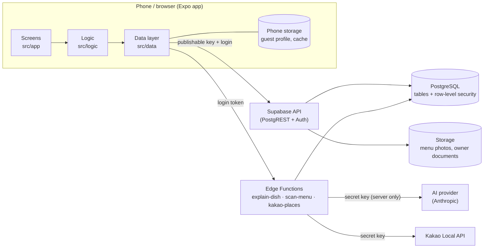

# Mukji (먹지)

**A food map for people who can't just eat anything.** Naver Map and Kakao Map tell you *where* a restaurant is. Mukji tells you **whether you can eat there, which dishes are safe for you, and how to ask in Korean**, based on your own food profile: halal, vegan, no pork, allergies, or no restriction at all.

Course project for AI+X 공학융합프로젝트 (Fall 2026), Hanyang University ERICA. Launch area: Ansan (안산시).

---

## The problem (문제 정의)

Foreign students and residents in Korea with a diet or an allergy can't tell from a Korean menu what is in a dish. Pork, beef stock, fish sauce, alcohol, peanuts and egg are often not in the dish name. Map apps show restaurants but not what you can eat there, and asking staff is hard without Korean. People end up eating at the same few places, or guessing.

## Who it is for (사용자)

- **Primary:** foreign students and residents around ERICA with a **diet** (halal, vegan, no pork) or a **food allergy** (peanut, seafood, egg, dairy, wheat, soy).
- **Also:** anyone choosing where to eat nearby, with no restriction.
- **Restaurant owners:** who want their menu shown correctly and to take bookings.
- **The Mukji team:** who check owner applications and menu submissions.

## What it does

**For users**
- **Map of Ansan restaurants.** Pins shrink as you zoom out and show names when you zoom in. Places with nothing for you are faded.
- **Food profile.** Pick diets and allergies once. Every dish is then marked **Safe**, **Ask first** or **Avoid**, with the reason (**Why?**).
- **AI explanations.** "Why?" can ask the AI to explain a dish and what to check with staff. The **Menu Scanner** reads a photo of a paper menu.
- **Ordering help.** A Korean order card and Korean sentences to show staff.
- **Bookings** with an optional pre-order, **reviews** after a visit, and **favourites**.
- **Account.** With email login, the profile, favourites and recent searches follow you to any phone (guests keep them on the phone).

**For owners and the team**
- **Owner Portal:** owners register, apply for their restaurant, and after approval edit info, photos and the menu, and answer bookings.
- **Team tools (4 team members only):** approve or reject owner applications, review menu submissions, and open any restaurant as owner for testing.

## The data, honestly

| What | Count | Where it comes from | How sure |
|---|---|---|---|
| Restaurants | 9,018 in Ansan | Public licence data (일반음식점 + 휴게음식점, 안산시) | Name, address, category, location |
| Chain menus | 136 branches, 15 chains | The chains' own websites and allergen tables | Official allergen info; English names translated by us |
| Typical menus | ~7,300 restaurants | Generated per category (e.g. 중국식, 분식) | **A guess, not the real menu.** Never shown as Safe; a banner says so |
| Real menus | a few restaurants | Owners, the team, menu scans | Checked by people |

No prices are invented, and no owner names or registration numbers are imported. See **[ETHICS.md](ETHICS.md)** for every data and privacy decision.

---

## How to run (실행 방법)

The app is an **Expo (React Native)** app. It connects to our shared Supabase project, so you don't need your own database to run it.

### 1. Install once

- **Node.js 22 LTS**: https://nodejs.org (includes `npm`)
- **Git**: https://git-scm.com
- On your phone: **Expo Go** (App Store / Play Store). Or use a web browser instead.

### 2. Get the code and the settings

```bash
git clone https://github.com/Irfnaimann02/mukji.git
cd mukji/mobile
npm install
```

Copy `.env.example` to `.env`:

```bash
cp .env.example .env        # Windows PowerShell: Copy-Item .env.example .env
```

Then fill in the two values from Supabase → Project Settings → API:

```
EXPO_PUBLIC_SUPABASE_URL=https://<project-ref>.supabase.co
EXPO_PUBLIC_SUPABASE_KEY=sb_publishable_...
```

These two are **public by design**: they ship inside every copy of the app, and the database's row-level security decides what anyone can read or write. Team members can ask Adib for the values of our project. Never put any other key in `.env` or in the code (see [Secrets](#secrets-비밀-정보)).

### 3. Start it

```bash
npx expo start
```

- **Phone:** scan the QR code (Camera app on iPhone, Expo Go on Android). Phone and laptop must be on the same Wi-Fi.
- **Browser:** press `w`, or run `npx expo start --web`. It opens at http://localhost:8081.

**Log in:** enter your email, then the 6-digit code from the email. Or continue as a guest.

### 4. Check it

```bash
npx tsc --noEmit     # types
npx expo lint        # lint
npm test             # 160 unit tests (Jest)
```

### Common problems

| You see | Fix |
|---|---|
| `package.json does not exist` | You are in the repo root. Run `cd mobile` first. |
| "Supabase is not configured" | `mobile/.env` is missing or empty (step 2). |
| QR code doesn't open | Phone and laptop on the same Wi-Fi, or try `npx expo start --tunnel`. |
| AI explanation not available | The Edge Function or its AI key isn't set up (only matters on your own Supabase). |

---

## Setting up your own Supabase (only for a new project)

You only need this to build a fresh copy of the backend. To just run the app, use ours (above).

1. **Create a project** at https://supabase.com and put its URL and publishable key in `mobile/.env`.
2. **Run the SQL files** in `supabase/sql/` **in number order** (001 → 046) in the SQL editor.
   - **Skip** `020_test_owner.sql` (old manual test) and `031_cleanup_test_data.sql` (one-off cleanup).
   - `033` is large: split it, or run it with `psql`.
   - After `037`, run `select * from public.apply_chain_menus();`. After `038`, run `select * from public.apply_typical_menus();`. In that order, so chain branches get their official menu first.
   - Most files have a matching test in `supabase/tests/`. Run it after the file; it rolls itself back.
3. **Deploy the Edge Functions** in `supabase/functions/`: `explain-dish`, `scan-menu`, `kakao-places`.
4. **Set the Edge Function secrets** (Supabase → Edge Functions → Secrets). Only the **names** are listed here, never the values:

   | Secret | What it is |
   |---|---|
   | `AI_PROVIDER` | `anthropic`, `openai` or `gemini` |
   | `AI_MODEL` | the model name for that provider |
   | `AI_SCAN_MODEL` | optional: a different model for the Menu Scanner |
   | `AI_API_KEY` | the AI provider's API key |
   | `KAKAO_REST_KEY` | Kakao Developers REST API key (place lookup) |

   We use Anthropic on a **prepaid credit with auto-reload off**, so cost can't run away. The database also limits AI calls per day (SQL 027): 30 explanations and 10 menu scans per person, and 1,000 / 200 for the whole app.
5. **Email login (OTP code).**
   - Supabase → Authentication → Email: enable email sign-in.
   - Set up **custom SMTP**. We use a Gmail address with a Gmail **app password**, stored only in Supabase.
   - Edit the "Magic Link" email template so it includes `{{ .Token }}`, the 6-digit code the app asks for.
6. **Add the team** (team-only tools):
   ```sql
   insert into public.team_members (user_id)
   select id from auth.users where email = 'someone@example.com'
   on conflict do nothing;
   ```

---

## Architecture (아키텍처)



- **App (`mobile/`)**: Expo SDK 58, React Native, TypeScript, Expo Router.
  - `src/app`: screens and routes.
  - `src/logic`: rules with no network, e.g. Safe / Ask first / Avoid and the map zoom.
  - `src/data`: the only code that talks to Supabase or phone storage.
- **Database (`supabase/sql/`)**: PostgreSQL with row-level security on every table.
  - Users only see their own bookings, profile and favourites. Reviews are public, but only their author can change them.
  - Owners see only their own restaurants.
  - Team-only tables and functions check `team_members`.
- **Edge Functions (`supabase/functions/`)**: the only place the AI and Kakao keys are used. The app never sees them.
- **Data scripts (`scripts/`, `supabase/tools/`)**: build the SQL for the Ansan import, chain menus, typical menus and English names, from the source files in `supabase/data/`.

## Secrets (비밀 정보)

| Secret | Where it lives | In git? |
|---|---|---|
| Supabase URL + publishable key | `mobile/.env` (public by design, protected by RLS) | `.env` is ignored; only `.env.example` with empty values is committed |
| AI API key, Kakao REST key | Supabase Edge Function secrets | Never |
| Gmail app password (SMTP) | Supabase Auth settings | Never |
| Supabase service-role key, database password | Supabase dashboard only; not used by the app | Never |

- **`.gitignore`** ignores `.env` and `.env*.local`.
- **History checked:** we scanned the whole commit history of every branch for API keys, service keys and passwords on 2026-11-28. None were found.

---

## Team (팀원)

| Member | GitHub | Main areas |
|---|---|---|
| Adib Fahmi | [@Adiboba](https://github.com/Adiboba) | Supabase database and security, data (Ansan import, chain and typical menus), owner approval, reviews |
| Irfan Aiman | [@Irfnaimann02](https://github.com/Irfnaimann02) | Map and pins, device fixes (iPhone, web, wide screens), demo and pitch |
| Aqil | [@Soy05](https://github.com/Soy05) | Owner Portal (dashboard, restaurant and menu management), screen design |
| Nik Ammar | [@nikmar9705](https://github.com/nikmar9705) | AI features (Why?, Menu Scanner), login and account, saved profile and favourites |

## Docs

- **[ETHICS.md](ETHICS.md)**: data, privacy and honesty decisions.
- **[PROMPTS.md](PROMPTS.md)**: every use of AI in building this, with what we changed.
- **[docs/ONBOARDING.md](docs/ONBOARDING.md)**: software to install, how we use GitHub.
- **[docs/proposal.md](docs/proposal.md)**: the original proposal.
- **[docs/week12-quality-check.md](docs/week12-quality-check.md)**: the Week 12 test and security check.
- **[docs/owner-portal-ui-spec.md](docs/owner-portal-ui-spec.md)**: Owner Portal screens.
- **[supabase/data/chains/README.md](supabase/data/chains/README.md)**: where the chain menus come from.

## How we work

- Work is tracked as **GitHub Issues**. One issue, one branch, one pull request. Titles start with `#N`, and PRs say `Closes #N`.
- Every PR is reviewed by another member and merged with a merge commit (no force push).
- Database changes are numbered SQL files with a test, run in Supabase after review.
- Any AI use is logged in `PROMPTS.md`.
